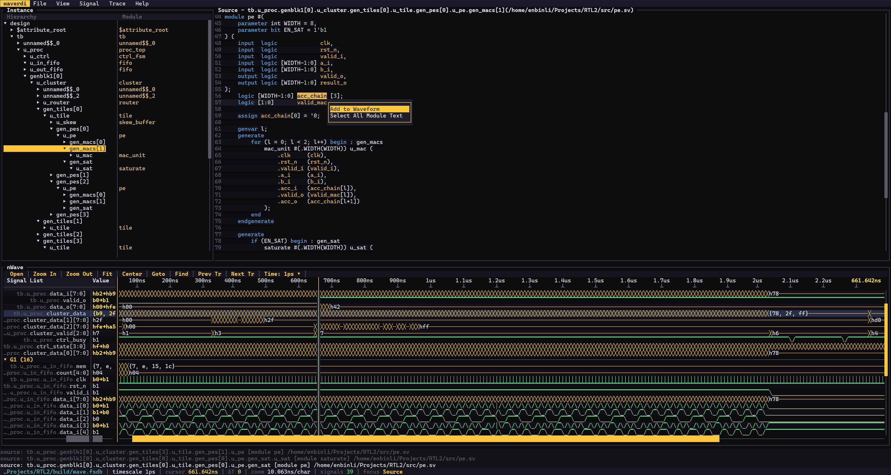

# waverdi

A Verdi-style RTL waveform viewer for the terminal, written in Rust.

**English** | [简体中文](README.zh-CN.md)

[](https://github.com/SolidFaker/waverdi/actions/workflows/ci.yml)
[](https://github.com/SolidFaker/waverdi/releases)

Open VCD, FST or FSDB dumps and browse hierarchy, RTL source and waveforms in one
TUI. waverdi works locally and over SSH, without requiring a desktop.



## Features

- **Waveform formats** — VCD, FST via [wellen](https://github.com/ekiwi/wellen),
  and FSDB through the Verdi FFR SDK on Linux.
- **RTL debugging** — highlighted source, declarations, drivers and loads,
  instance/generate-aware signal resolution, arrays and bus operations.
- **Follow Signal** — trace a signal through assignments and instance ports,
  then jump to the connected module and source line.
- **Navigation** — vim keys, multi-selection, user groups, hierarchy history,
  source search, radix selection and analog/digital rendering.
- **Interactive UI** — mouse menus, draggable panes and scrollbars, themes,
  custom shortcuts, colors and general settings.
- **Search tools** — literal or regex search, optional case sensitivity, match
  highlighting, and forward/backward search with wraparound.

## Build

Install stable Rust 1.90 or newer, then run:

```sh
git clone https://github.com/SolidFaker/waverdi.git
cd waverdi
cargo build --release
```

The executable is written to `target/release/waverdi` (or `waverdi.exe` on
Windows). A C++ toolchain is only needed for direct FSDB support on Linux.
Windows and macOS can view VCD and FST files without it.

For a smaller, GUI-free build that always uses the terminal file browser:

```sh
cargo build --release --no-default-features
```

### FSDB on Linux

Direct FSDB reading uses the FSDB Reader SDK bundled with Verdi. Configure the
Synopsys environment before building:

```sh
source /path/to/synopsys/env.sh   # sets VERDI_HOME and related variables
cargo build --release
```

Without the SDK, waverdi still builds and suggests converting FSDB files with
`fsdb2vcd` when necessary.

## Usage

```sh
waverdi waveform/counter.vcd                 # open a VCD dump
waverdi waveform/demo.fst                    # open an FST dump
waverdi wave.fsdb                            # open FSDB (with the Verdi SDK)
waverdi -f rtl.f wave.fsdb                   # include an RTL filelist
waverdi --list-signals waveform/complex.vcd  # print hierarchy and exit
waverdi --no-gui waveform/counter.vcd        # force the terminal file browser
waverdi --gui waveform/counter.vcd           # force the native file dialog
```

Example files are included in `waveform/`.

The Source pane uses the filelist supplied with `-f` or **File ▸ Load
Filelist...**. FSDB source lists can also be recovered from the Verdi KDB next
to the dump. If no list is available, nearby `.v` and `.sv` files are scanned.

## Common controls

| Key | Action |
| --- | --- |
| `q`, `Ctrl+C/Q` | quit |
| `o` / `O` | open a waveform (native dialog / terminal browser) |
| `Tab` | cycle focus: Instance, Source, Signal List, Waveform |
| `j` / `k` | move down / up |
| `J` / `K` | move the selected signal or group down / up |
| `Enter` / `a` | expand an instance or add the source signal under the cursor |
| `dd` / `p` | cut / paste selected signals |
| `V`, `Space` | start or extend a multi-selection |
| `s` | search signals |
| `v`, then `n` / `N` | find a value, then next / previous match |
| `z` / `Z`, `f`, `c` | zoom in / out, fit, center |
| `:` | go to time |
| `h` / `l` or arrows | move the cursor |
| `F2` | settings |
| `F1`, `?` | all key bindings |

Mouse users can click menus and toolbar buttons, drag pane borders and
scrollbars, reorder signals or groups, select time ranges, and right-click for
context actions.

## Source and navigation

- **Source search** — use the search box below the main menu. `Aa` toggles case
  sensitivity and `.*` toggles regex mode. `▼` / `▲` search downward / upward;
  Enter searches down and Shift+Enter searches up. Matches are highlighted.
- **Hierarchy and history** — `↑` / `↓` move to parent / child instances;
  `←` / `→` move backward / forward through source locations.
- **Follow Signal** — right-click a signal in Source and choose **Follow
  Signal** to list connected modules and jump to a target.
- **Copy paths** — Hierarchy provides **Copy Full Path** and **Expand Tree by
  Level**; Source provides **Copy File Path**. Clipboard copy uses OSC 52 when
  supported by the terminal.
- **Bus operations** — split a bus into chunks or create a named bus from
  selected signals. Create Bus includes ordering, slicing and a custom name
  field; blank keeps automatic naming.

## Settings

`F2` opens the settings dialog with category navigation on the left and items
on the right. It includes:

- General behavior and waveform value overflow.
- Dark, light and mixed themes, plus a color picker for UI and waveform colors.
- Editable key bindings with individual and full reset options.

Changes last for the current session.

## Development

```sh
cargo fmt --check
cargo test
cargo test --no-default-features
cargo clippy --all-targets -- -D warnings
cargo build --release
```

Run FSDB tests in an environment with `VERDI_HOME` configured. Optional
performance scenarios are available with:

```sh
cargo test --release perf:: -- --ignored --nocapture --test-threads=1
```

## Planned formats

Cadence SHM and ModelSim/Questa WLF are not implemented yet. The current plan
is to support conversion to VCD before considering native readers.
