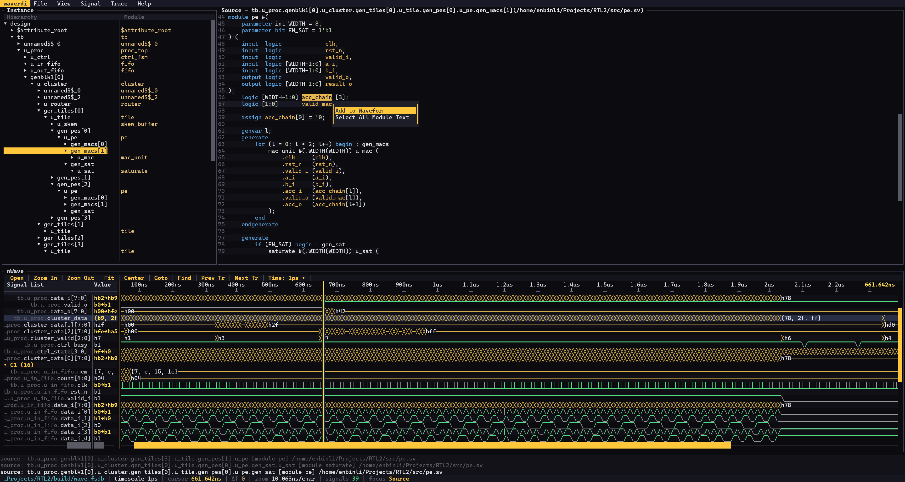

# waverdi

终端里的 Verdi 风格 RTL 波形查看器，使用 Rust 编写。

[English](README.md) | **简体中文**

[](https://github.com/SolidFaker/waverdi/actions/workflows/ci.yml)
[](https://github.com/SolidFaker/waverdi/releases)

打开 VCD、FST 或 FSDB，在同一个 TUI 中浏览实例层次、RTL 源码和波形。支持
本地及 SSH 环境，无需图形桌面。



## 功能

- **波形格式** — VCD、FST（[wellen](https://github.com/ekiwi/wellen)），以及
  Linux 上通过 Verdi FFR SDK 读取的 FSDB。
- **RTL 调试** — 高亮源码、声明/驱动/负载、实例与 generate 感知的信号解析、
  数组和总线操作。
- **Follow Signal** — 沿连续赋值和实例端口追踪信号，并跳转到关联模块和源码行。
- **导航操作** — vim 按键、多选、用户分组、层次历史、源码搜索、进制切换、
  数字/模拟波形。
- **交互界面** — 鼠标菜单、面板与滚动条拖动、主题、自定义快捷键、颜色与常规设置。
- **搜索工具** — 普通文本或正则搜索、可选大小写敏感、命中高亮、双向循环查找。

## 构建

安装 stable Rust 1.90 或更新版本，然后执行：

```sh
git clone https://github.com/SolidFaker/waverdi.git
cd waverdi
cargo build --release
```

产物位于 `target/release/waverdi`（Windows 为 `waverdi.exe`）。只有 Linux
上的直接 FSDB 支持需要 C++ 工具链；Windows 和 macOS 可直接查看 VCD 与 FST。

如需不含 GUI 依赖、始终使用终端文件浏览器的构建：

```sh
cargo build --release --no-default-features
```

### Linux 上的 FSDB

直接读取 FSDB 使用 Verdi 自带的 FSDB Reader SDK。构建前配置 Synopsys 环境：

```sh
source /path/to/synopsys/env.sh   # 设置 VERDI_HOME 等变量
cargo build --release
```

没有 SDK 时仍可构建；打开 FSDB 时会提示可通过 `fsdb2vcd` 转换。

## 使用

```sh
waverdi waveform/counter.vcd                 # 打开 VCD
waverdi waveform/demo.fst                    # 打开 FST
waverdi wave.fsdb                            # 打开 FSDB（需 Verdi SDK）
waverdi -f rtl.f wave.fsdb                   # 同时指定 RTL filelist
waverdi --list-signals waveform/complex.vcd  # 打印层次后退出
waverdi --no-gui waveform/counter.vcd        # 强制使用内置文件浏览器
waverdi --gui waveform/counter.vcd           # 强制使用系统文件对话框
```

`waveform/` 目录中包含示例文件。

Source 面板使用 `-f` 或 **File ▸ Load Filelist...** 提供的 RTL 文件列表。
打开 FSDB 时也可从其旁边的 Verdi KDB 恢复源文件列表；没有列表时会扫描附近的
`.v` / `.sv` 文件。

## 常用按键

| 按键 | 功能 |
| --- | --- |
| `q`、`Ctrl+C/Q` | 退出 |
| `o` / `O` | 打开波形（系统对话框 / 内置浏览器） |
| `Tab` | 在 Instance、Source、Signal List、Waveform 间切换 |
| `j` / `k` | 向下 / 向上移动 |
| `J` / `K` | 向下 / 向上移动所选信号或分组 |
| `Enter` / `a` | 展开实例，或添加 Source 光标处的信号 |
| `dd` / `p` | 剪切 / 粘贴所选信号 |
| `V`、`Space` | 开始或扩展多选 |
| `s` | 搜索信号 |
| `v`，然后 `n` / `N` | 查找数值，然后下一个 / 上一个匹配 |
| `z` / `Z`、`f`、`c` | 放大 / 缩小、适配、居中 |
| `:` | 跳转到指定时间 |
| `h` / `l` 或方向键 | 移动光标 |
| `F2` | 设置 |
| `F1`、`?` | 全部按键帮助 |

鼠标可点击菜单和工具栏、拖动面板边框与滚动条、调整信号及分组顺序、选择时间
范围，并通过右键打开上下文菜单。

## Source 与导航

- **源码搜索** — 使用主菜单下方的搜索框。`Aa` 切换大小写敏感，`.*` 切换正则
  模式；`▼` / `▲` 向下 / 向上搜索，Enter 向下、Shift+Enter 向上，命中范围高亮。
- **层次与历史** — `↑` / `↓` 进入父级 / 子级实例；`←` / `→` 在源码位置之间
  后退 / 前进。
- **Follow Signal** — 在 Source 中右键信号并选择 **Follow Signal**，查看关联
  模块并跳转到对应位置。
- **路径复制** — Hierarchy 提供 **Copy Full Path** 和 **Expand Tree by Level**；
  Source 提供 **Copy File Path**。复制使用 OSC 52，需终端支持。
- **总线操作** — 可将总线拆分为多个片段，也可把多个信号合成为总线。Create Bus
  支持排序、位范围调整和自定义名称，名称留空时自动命名。

## 设置

`F2` 打开设置窗口，左侧为类别、右侧为具体项目：

- 常规行为与波形数值溢出显示方式。
- Dark、Light、Mixed 主题，以及 UI 和波形颜色选择器。
- 可编辑快捷键，支持单项恢复默认和全部恢复默认。

修改在本次会话中生效。

## 开发

```sh
cargo fmt --check
cargo test
cargo test --no-default-features
cargo clippy --all-targets -- -D warnings
cargo build --release
```

FSDB 测试需要先配置 `VERDI_HOME`。可选性能场景：

```sh
cargo test --release perf:: -- --ignored --nocapture --test-threads=1
```

## 待办

尚未支持 Cadence SHM 与 ModelSim/Questa WLF。计划先通过转换为 VCD 支持这些
格式，再评估是否需要原生读取器。
